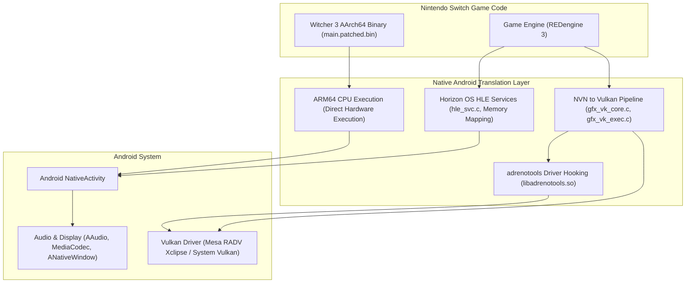

# The Witcher 3: Wild Hunt — Native Android Port

[](https://www.android.com/)
[](https://www.vulkan.org/)
[](https://www.thewitcher.com/)
[](LICENSE)

### Note: This project is entirely made by gemini, with me testing the game on my phone. The game is in a very rough stage, it doesn't even load into kear morhen right now.

A high-performance native port of **The Witcher 3: Wild Hunt** (Nintendo Switch edition) to 64-bit ARM Android devices.

Unlike traditional emulation, this project executes the original Nintendo Switch AArch64 machine instructions **directly on the phone's ARM64 CPU** with zero CPU emulation overhead. Switch system services (Horizon OS) are handled via High-Level Emulation (HLE), and proprietary NVN graphics calls are translated directly into modern Vulkan hardware commands.

---

## Architecture Overview



### Key Pillars

1. **Direct ARM64 Execution**:
   Because both the Nintendo Switch and modern Android devices utilize ARM64 (AArch64) architecture, game logic, AI, physics, and REDengine script bytecode run at full bare-metal CPU speed without an instruction translator or JIT recompiler.
2. **Horizon OS HLE**:
   Switch kernel syscalls (`svc`), IPC ports, thread schedulers, and synchronization primitives (mutexes, condition variables, event objects) are mapped directly to Linux POSIX kernel primitives (`futex`, `pthread`, `mmap`).
3. **NVN-to-Vulkan Hardware Translation**:
   The Nintendo Switch NVN graphics pipeline commands are intercepted and replayed directly onto Vulkan 1.3+ command buffers, converting Maxwell-specific state into standard Vulkan pipeline states and descriptors.

---

## Samsung Exynos 2400 & AMD RDNA 3 (Xclipse 940) Optimizations

Significant engineering went into stabilizing and accelerating the port on the **Samsung Exynos 2400** chipset (Samsung Galaxy S24 / S24 FE series), featuring the **AMD RDNA 3 Xclipse 940 GPU**:

### 1. GPU Watchdog & Phone Reboot Prevention (`DM_VK_SUBMIT_SPLIT=0`)
* **Problem**: Samsung's display subsystem runs a kernel-level hardware watchdog (`HWCWatchdogThread` in `/vendor/lib64/libexynosdisplay.so`) that forces a hard device reboot if the display composer is starved for 5.0 seconds (`HWComposer RESET by watchdog !!`). Partial mid-frame command buffer flushes caused depth-cache lockups during complex 3D scenes (such as Kaer Morhen) that stalled for 5.75s.
* **Resolution**: Frame work is synchronized into a single atomic frame submission at `vkQueuePresentKHR` with timeline semaphores, ensuring continuous frame pacing and eliminating watchdog triggers.

### 2. Multi-Threaded Pipeline Cache Data Race Fix (`g_pcache_mu`)
* **Problem**: Concurrent background shader prewarm threads accessing Samsung's proprietary pipeline cache compiler caused memory corruption and segmentation faults (`CRASH sig=11 in vulkan.samsung.so`).
* **Resolution**: Implemented thread-safe mutex gating (`g_pcache_mu`) around `vkCreateGraphicsPipelines` and `vkCreateComputePipelines`, and capped background worker threads (`DM_VK_PREWARM_THREADS=1`).

### 3. Mesa RADV Xclipse & Custom Driver Integration
* **Problem**: Stock factory drivers often lack hardware BC (Block Compression) texture support or encounter high shader compile stuttering on mobile chips.
* **Resolution**: Integrated custom driver loading via `adrenotools`. The port natively bundles and supports upstream **Mesa RADV Xclipse** (`libvulkan_radeon.so`), featuring:
  * **ACO Compiler**: Near-instantaneous shader compilation without multi-second stalls.
  * **Native Hardware BC Texture Decoding**: Bypasses slow CPU software decompression, unlocking full 30–60 FPS rendering in open-world scenes.

---

## Repository Structure

```
witcher3-android/
├── build.sh                      # Unified build script (host library + APK)
├── deploy/
│   ├── deploy.sh                 # ADB deployment and configuration tool
│   ├── env.txt                   # Verified game configuration & driver settings
│   ├── nintendo_ext.ttf          # Stand-in controller glyph font
│   └── nx2a-data.json            # Game title descriptor metadata
├── nxnative/
│   ├── AGENTS.md                 # Technical notes for agentic contributors
│   └── dm/
│       ├── android/              # Android NativeActivity frontend & Vulkan backend
│       │   ├── build.py          # NDK compiler script
│       │   ├── front_android.c   # Lifecycle, window management, adrenotools init
│       │   ├── gfx_vk_core.c     # Vulkan instance, device, driver loading
│       │   ├── gfx_vk_exec.c     # Vulkan command buffer execution & pcache mutex
│       │   ├── gfx_vk_tex.c      # Texture formats, BC decompression handlers
│       │   └── apk/mkapk.py      # Standalone APK assembler & v2 signer
│       ├── games/
│       │   └── 0100E67012924000/ # Witcher 3 Wild Hunt profile & shader maps
│       │       ├── game.tsv      # Memory limits (64GB virtual space), modules
│       │       ├── android.tsv   # Package identity & orientation
│       │       └── shader_map.tsv# Maxwell to Vulkan shader bindings
│       ├── host/                 # Horizon OS kernel HLE (hle_svc.c, memory)
│       └── third_party/          # Bundled dependencies (adrenotools, zstd, etc.)
├── packaging/
│   └── icons/                    # High-resolution application icons
├── porter/                       # CLI tool for extracting & patching game NSPs
└── docs/                         # Technical architecture documentation
```

---

## Requirements

### Host Build Machine
* **Operating System**: Linux (Ubuntu 22.04+ recommended), macOS, or Windows (WSL2).
* **Android NDK**: Version **r27c** (or r26b+).
* **Python**: 3.10 or newer.
* **Android Platform Tools**: `adb` installed and present in `PATH`.

### Target Device
* **Architecture**: 64-bit ARM (`arm64-v8a`).
* **OS**: Android 12 or newer (API level 31+).
* **GPU**: Must support **Vulkan 1.3** and texture compression (Adreno 6xx/7xx/8xx, Samsung Xclipse 920/940).
* **Storage**: Minimum 16 GB free internal flash storage.
* **Game Dump**: A legally dumped Nintendo Switch copy of *The Witcher 3: Wild Hunt* (`0100E67012924000`) and your console's `prod.keys`.

---

## Building from Source

### 1. Build the APK and Native Runtime

Clone the repository and run the build script:

```bash
git clone https://github.com/your-username/witcher3-android.git
cd witcher3-android

# Ensure ANDROID_NDK_HOME points to your NDK, or pass --ndk
export ANDROID_NDK_HOME=$HOME/Android/Sdk/ndk/27.2.12479018

# Build debug APK with adrenotools support
./build.sh
```

**Options for `build.sh`**:
* `--release`: Strips debug symbols and enables compiler optimizations (`-O2`).
* `--jobs <N>`: Sets parallel compiler threads (defaults to CPU count).
* `--version-code <N>`: Sets the APK `versionCode` (default: `8`).
* `--driver <path>`: Bundles an external Vulkan driver `.so` into the APK.

The output APK will be placed in:
```
build/TheWitcher3WildHunt.apk
```

---

## Deployment & Game Asset Setup

### 1. Prepare Game Assets

The repository does **not** contain proprietary game files. You must extract them from your legal game dump:

```bash
# Extract and patch game binaries using porter
python3 -m porter port /path/to/witcher3_dump/ -k /path/to/prod.keys -o ./game_assets
```

This creates:
* `RomFS/`: Extracted game data (~14.5 GB).
* `mods/`: Patched executables (`main.patched.bin`, `sdk.patched.bin`).
* `shaders.dmsv`: Translated Vulkan shader cache.

### 2. Deploy via ADB

Connect your phone with **USB Debugging** enabled and execute:

```bash
./deploy/deploy.sh
```

The script will:
1. Install `TheWitcher3WildHunt.apk`.
2. Grant `MANAGE_EXTERNAL_STORAGE` permissions.
3. Push `env.txt`, `nx2a-data.json`, and `nintendo_ext.ttf` to `/sdcard/TheWitcher3/`.
4. Prompt to transfer `shaders.dmsv`, `mods/`, and `RomFS/`.

### 3. Manual Storage Layout (USB MTP)

If transferring over USB file transfer instead of ADB, place game assets in your phone's **Internal Shared Storage**:

```
/sdcard/TheWitcher3/ (or /storage/emulated/0/TheWitcher3/)
├── RomFS/                 # 14.5 GB game archives (content/, etc.)
├── mods/                  # main.patched.bin, sdk.patched.bin
├── shaders.dmsv           # Precompiled Vulkan SPIR-V shaders
├── drivers/               # Optional: libvulkan_radeon.so
├── env.txt                # Configuration file
├── nintendo_ext.ttf       # Controller button glyph stand-in font
└── nx2a-data.json         # Title metadata
```

---

## Configuration (`env.txt`)

Adjust performance and engine behavior by editing `/sdcard/TheWitcher3/env.txt`:

| Variable | Recommended Value | Description |
| :--- | :---: | :--- |
| `DM_VK_DRIVER` | `libvulkan_radeon.so` | Vulkan driver: `libvulkan_radeon.so` (RADV Xclipse), `system` (stock driver), or custom driver file name. |
| `DM_VK_SUBMIT_SPLIT` | `0` | **Crucial for Exynos 2400**: `0` submits work once per frame. Prevents display watchdog timeouts and phone reboots. |
| `DM_VK_PREWARM_THREADS` | `1` | Number of background pipeline compilation threads. Set to `1` to avoid pipeline cache race conditions. |
| `DM_VK_MT_REPLAY` | `1` | Multi-threaded command buffer replay. |
| `DM_FPS_TARGET` | `30` | Target frame rate (e.g. `30` or `60`). |
| `DM_APP_POOL` | `0xCD500000` | Application memory allocation block for REDengine 3. |
| `DM_LANG` | `en-US` | Audio and subtitle language identifier. |
| `DM_OPMODE` | `0` | Switch operating mode: `0` = Handheld (720p), `1` = Docked (1080p). |

---

## Troubleshooting & FAQ

#### Q: The phone suddenly reboots during the loading screen or Kaer Morhen intro!
**A:** This is caused by the Samsung display watchdog detecting a GPU stall. Ensure `DM_VK_SUBMIT_SPLIT=0` is set in `/sdcard/TheWitcher3/env.txt`.

#### Q: In-game text and button prompts are missing or blank.
**A:** Verify that `nintendo_ext.ttf` is present in `/sdcard/TheWitcher3/`. The game requires this stand-in font to display controller glyphs.

#### Q: Gameplay runs at <1 FPS in 3D areas.
**A:** Ensure you are using the Mesa RADV Xclipse driver (`DM_VK_DRIVER=libvulkan_radeon.so`). Stock drivers without hardware BC texture support fall back to software texture decoding.

#### Q: How can I check runtime logs?
**A:** Run:
```bash
adb logcat -s dmhost:V AndroidRuntime:E
```
Logs are also saved directly to `/sdcard/TheWitcher3/log.txt` on the device.

---

## Credits & Acknowledgements

* **CD PROJEKT RED** & **Saber Interactive**: Developers and porters of *The Witcher 3: Wild Hunt*.
* **nx2android** & **nxnative**: Core Horizon OS HLE and NVN-to-Vulkan translation runtime.
* **JimVulkan**: [radv-xclipse](https://github.com/JimVulkan/radv-xclipse) upstream Mesa driver builds for Samsung Exynos.
* **adrenotools**: Dynamic Android Vulkan driver replacement hooks.
* **Ryujinx**: Groundbreaking work on Nintendo Switch shader translation and Maxwell GPU emulation.

---

## Legal Disclaimer

*The Witcher 3: Wild Hunt* is a registered trademark of CD PROJEKT S.A. Nintendo Switch is a registered trademark of Nintendo Co., Ltd.

This repository contains **NO copyrighted game assets, proprietary ROMs, decrypted binaries, or cryptographic keys**. Users must supply their own legally purchased copy of the game and dump their own assets to use this software.
